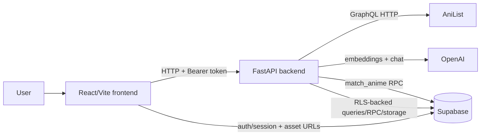

# Codebase reacclimation: AniLoaded

(**_Help new collaborators as well as us to remember the system architecture we designed so we can read through and get a mental map_**)

> **Architecture document status:** inspected `main` at commit `943d7eee9945fbdb6cce728313427a3f56515b88` on 2026-10-26. The editable diagram source is included. PNG rendering is still pending because the local Excalidraw CLI could not find an installed browser.

## Executive summary

AniLoaded is a two-process anime and community app. The frontend uses React 19, Vite, React Router, and TanStack Query. The backend uses FastAPI and coordinates AniList, Supabase, and the recommendation pipeline built with OpenAI and LangChain.

The browser handles pages, form state, query caching, and the Supabase session. FastAPI handles authorization checks, database writes, external API calls, and recommendation work. AniList supplies anime metadata. Supabase stores users and app data. OpenAI and Supabase vector search produce recommendations.

## How to run it

From `App/`:

```bash
docker compose up --build
# frontend: http://localhost:5173
# backend:  http://localhost:8000
```

Or run the processes directly:

```bash
cd App/frontend && npm ci && npm run dev
cd App/backend && uvicorn main:app --reload
```

Useful checks:

```bash
cd App/frontend && npm run test:run && npm run build
cd App/backend && pytest
```

The backend environment names are listed in `App/backend/.env.example`: `SUPABASE_URL`, `SUPABASE_KEY`, `SUPABASE_SERVICE_KEY` for seeding, `STORAGE_KEY_DISCUSSION`, and `OPENAI_API_KEY`. `main.py` also reads `LOG_LEVEL`, although that variable is not in the example file.

The frontend reads `VITE_BACKEND_URL`, `VITE_SUPABASE_URL`, `VITE_SUPABASE_KEY`, and the Supabase asset bucket and folder variables listed in `App/frontend/src/.env.example`.

A few setup details are easy to miss:

- The frontend requires `VITE_BACKEND_URL` when its API module loads.
- Docker Compose does not inject backend secrets.
- The backend expects to run from its working directory.
- The preview workflow points to `infra/envs/preview`, but that directory is not in this checkout.

## Repository map

```text
App/
  frontend/              React/Vite application, routes, UI, API clients, tests
  backend/               FastAPI app, routers, schemas, integrations, tests
  docker-compose.yml     local frontend/backend development containers
infra/
  envs/{dev,prod}/       Terraform environment shells, currently mostly placeholders
  modules/                module documentation; implementations are not present here
.github/workflows/
  test.yml               frontend and backend CI tests
  preview-deploy.yml     AWS/Terraform preview deployment workflow
```

This document is the main architecture and reacclimation guide. The source tree and route files remain the authority for implementation details.

## Architecture overview

`App/frontend/src/main.tsx` mounts the app and the TanStack Query provider. `App/frontend/src/App.tsx` defines the route tree and adds `AuthProvider`. `App/backend/main.py` loads dotenv, configures logging and CORS, creates the FastAPI app, and registers the routers.



The editable overview is [system-overview.excalidraw](architecture/system-overview.excalidraw). PNG rendering is pending a local Chromium, Chrome, or Firefox installation; no PNG is claimed as current.

## Frontend

### Entry point and routes

- `App/frontend/src/main.tsx` mounts the root element, the `QueryClientProvider`, and a toaster.
- `App/frontend/src/App.tsx` creates the browser router. `RootLayout` wraps product pages, while `AuthLayout` wraps `/auth/login` and `/auth/signup`.
- The product routes are `/`, `/anime`, `/anime/:id`, `/discussions`, `/discussion/:id`, `/discussion/submit`, `/lists`, `/list/create`, `/list/:id`, `/recommendations`, and `/profile`.
- Loaders prefetch home, anime, discussion, and category data into `services/clients/queryClient.ts`.

`AuthProvider` (`services/supabase/hooks/AuthProvider.tsx`) uses `useAuth.ts` to listen for Supabase auth changes and fetch the current user on startup. The app does not have one protected-route wrapper. Pages such as recommendations perform their own redirect after auth loading finishes.

### Data flow

The feature clients in `frontend/src/services/api/` use Axios with `VITE_BACKEND_URL`. Several clients parse responses with Zod. TanStack Query owns the server cache, and mutations either update that cache directly or invalidate it.

The browser talks directly to Supabase for authentication and homepage asset lookups. Most application data goes through FastAPI instead.

## Backend

`App/backend/main.py` is the process entry point, normally started with `uvicorn main:app`. HTTP middleware preserves or creates an `X-Request-ID` and logs request start, completion, duration, status, and failures. CORS currently allows only `http://localhost:5173`, with `allow_credentials=False`.

The routers provide these endpoints:

- `routers/health.py` exposes `GET /` as a smoke test.
- `routers/anime.py` exposes anime genres, seasons, category searches, popular, trending, top-rated, and detail endpoints. It calls AniList through shared HTTP and error handling and uses an in-memory cache.
- `routers/discussions.py` handles public reads and authenticated discussion creation, comments, upvotes, edits, and deletes. Optional thumbnails go to Supabase Storage.
- `routers/lists.py` handles public list reads, authenticated list writes, and watchlist CRUD. `GET /user-lists` and `GET /popular-lists` currently have empty bodies.
- `routers/recommendations.py` handles authenticated conversation reads, creation, and message processing.

`utilities/auth_validator.py` requires a Bearer header and asks Supabase Auth to validate it. `database/supabase_client.py` creates a client per authenticated request. Unauthenticated reads use a shared client, which `main.py` closes during application shutdown.

## Key end-to-end flows

### Read flow: anime browse and detail

1. `HomePage.tsx`, `AnimeCategoriesPage.tsx`, or `AnimeInfoPage.tsx` calls a client such as `fetchAnimes.ts`.
2. Axios requests `/anime/trending`, `/anime/categories`, or `/anime/{id}` on FastAPI.
3. `routers/anime.py` builds an AniList GraphQL request, handles upstream errors, and caches selected responses through `utilities/cache.py`.
4. AniList returns the media data, and FastAPI passes it back in the shape expected by the frontend.
5. TanStack Query stores the result and React renders it. Watchlist actions use authenticated list endpoints.

The frontend converts Axios failures into app errors. The backend normalizes AniList status and request errors. Route loaders provide the page-level failure path. The cache belongs to one backend process, so replicas do not share it.

### Authenticated write flow: recommendation message

1. `RecommendationsPage.tsx` waits for a Supabase user and `recommendationService.ts` gets the current access token.
2. The browser sends `POST /recommendations/conversations/{session_id}/messages` with an `Authorization: Bearer ...` header.
3. `auth_validator` validates the token. `_get_session_for_user` checks that the conversation belongs to that user.
4. `routers/recommendations.py` saves the user message in `chat_messages`, titles a new session, loads recent history, and calls `rag.get_filtered_recommendations`.
5. The RAG service creates an OpenAI embedding, calls the Supabase `match_anime` RPC, reads the user's completed `user_watchlist`, and removes completed titles.
6. `agents/recommendation_agent.py` runs the LangChain/OpenAI agent with the remaining candidates and recent messages.
7. The route saves the assistant message, updates session activity, and returns the conversation. The frontend validates the response with Zod and updates TanStack Query.

If the AI pipeline fails after the user message is saved, the route returns HTTP 500 and tries to update the session metadata. It does not undo the saved user message.

### Write flow: discussion submission

`DiscussionSubmitPage.tsx` validates a multipart form with TanStack Form and Zod. `discussionService.ts` sends it to `POST /discussion`. The backend validates the user, checks the AniList anime ID, optionally uploads a thumbnail to the configured Supabase Storage bucket, upserts the referenced anime row, and inserts the discussion. A delete removes associated comments and upvotes and attempts to remove the thumbnail.

## Data model and integrations

The code refers to these Supabase tables or entities: `profiles`, `anime`, `discussions`, `discussion_categories`, `discussions_comments`, `discussion_upvotes`, `comment_upvotes`, `user_list`, `user_list_entry`, `user_watchlist`, `chat_sessions`, `chat_messages`, and `anime_embeddings`.

It also calls these RPCs: `match_anime`, `toggle_discussion_upvote`, `toggle_comment_upvote`, and `update_list_and_entries`.

The repository does not contain the SQL schema or RLS policies, so the exact relationships, permissions, and cascade behavior need to be checked in the Supabase project.

External services used by the code are:

- **AniList GraphQL:** anime metadata, ID validation, and list-entry hydration.
- **Supabase Auth, PostgREST, and Storage:** identity, app data, RPCs, and discussion thumbnails.
- **OpenAI:** embeddings and chat model calls.
- **LangChain and LangGraph:** recommendation-agent orchestration.

## Configuration and deployment

`App/docker-compose.yml` runs two live-reload containers for local development. `.github/workflows/test.yml` runs Vitest and pytest with placeholder environment values.

The manual preview workflow in `.github/workflows/preview-deploy.yml` is intended to provision Terraform, build and push a backend image to ECR, update ECS, build the frontend, upload it to S3, and invalidate CloudFront.

That workflow expects `infra/envs/preview`, but this checkout contains only `infra/envs/dev` and `infra/envs/prod`. Those files contain placeholder locals and no active module blocks. `infra/README.md` describes the infrastructure as phased work. Treat the preview deployment as unverified until the missing path and Terraform modules are restored.

## Risks, unknowns, and stale-looking areas

### Confirmed in the repository

- `GET /user-lists` and `GET /popular-lists` are stubs.
- `frontend/src/services/api/fetchAnimes.ts` exports an empty `usersTopAnime` function.
- The preview workflow points to a missing Terraform environment.
- `main.py` allows only the local frontend origin through CORS.
- The recommendation route saves a user message before running the AI pipeline, so a failed generation can leave a user-only message.

### Likely technical debt

- `frontend/src/lib/queryClient.ts` duplicates the active query-client file in `services/clients/`.
- `VITE_API_BASE_URL` appears in examples and CI, but the API clients use `VITE_BACKEND_URL`.

### Questions that need runtime checks

- What RLS policies, SQL schema, RPC implementations, and storage policies exist in Supabase?
- Does the production proxy route `/api` to ECS as the preview workflow expects?
- What AniList and OpenAI quotas, timeouts, and retry behavior apply in production?
- When will the Terraform modules and remote state configuration be available?

### Test and documentation gaps

The backend has route and helper tests with mocked external services. Frontend tests cover API modules and components, but no browser-level end-to-end suite appears in the repository. There is also no checked-in Supabase migration or schema directory.

## Best next reading order

1. `App/frontend/src/App.tsx`
2. `App/frontend/src/services/api/fetchAnimes.ts` and `recommendationService.ts`
3. `App/frontend/src/services/supabase/hooks/useAuth.ts`
4. `App/backend/main.py`
5. `App/backend/routers/anime.py`, `discussions.py`, `lists.py`, and `recommendations.py`
6. `App/backend/database/supabase_client.py` and `utilities/auth_validator.py`
7. `App/backend/rag/rag_service.py` and `agents/recommendation_agent.py`
8. `.github/workflows/preview-deploy.yml` and `infra/envs/*`

## Glossary

- **AniList:** external GraphQL source for anime metadata.
- **RAG:** retrieval-augmented generation. Here, it means embedding search followed by watchlist filtering before the agent responds.
- **RLS:** Supabase Row Level Security. The policies are not in this repository.
- **Session:** a saved recommendation conversation in `chat_sessions` with messages in `chat_messages`.
- **Hydration:** adding current AniList media data to rows read from Supabase.
